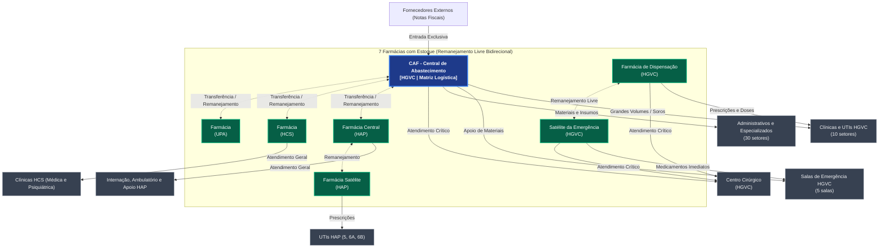

# 🗺️ Mapeamento de Setores e Fluxo de Distribuição — ProGest

> **Documento Oficial de Distribuição** — Estrutura topológica oficial e matriz de abastecimento provisionada pelo seeder de produção:  
> `docker compose -f docker-compose.local.yml exec progest-api php artisan migrate:fresh --seed`  
> *(Fontes no código: `DatabaseSeeder.php` e `PolosESetoresFullSeeder.php`)*.  
> 
> * Para permissões e regras por perfil, consulte **[perfis_implementados.md](perfis_implementados.md)**.  
> * Para o fluxo operacional dos usuários, consulte **[manual_do_usuario.md](manual_do_usuario.md)**.

---

## 1. Classificação Fundamental dos Setores

Todo o fluxo logístico e assistencial do sistema está estruturado em **três categorias essenciais de setores**:

```
                       ┌─────────────────────────────────────────┐
                       │                   CAF                   │
                       │    (Central de Abastecimento Farm.)     │
                       │    Único com Entrada de Notas Fiscais   │
                       └────────────────────┬────────────────────┘
                                            │
                    ┌───────────────────────┴───────────────────────┐
                    ▼                                               ▼
         ┌─────────────────────┐                         ┌─────────────────────┐
         │ Setores com Estoque │                         │ Setores sem Estoque │
         │ Farmácias Satélites │                         │ UTIs, Enfermarias,  │
         │ Controle Físico FIFO│                         │ Clínicas e Apoio    │
         │    (Almoxarife)     │                         │    (Solicitante)    │
         └──────────┬──────────┘                         └─────────────────────┘
                    │                                               ▲
                    └───────────────────────────────────────────────┘
                                Abastecimento Local
```

### 1.1. CAF (Central de Abastecimento Farmacêutico)
* **Função:** Matriz logística de suprimentos de todo o complexo hospitalar (Polo HGVC).
* **Entrada de Mercadorias:** **Exclusividade da CAF**. É o único local onde são lançadas Notas Fiscais (NF) de fornecedores externos, com cálculo automático e rateio financeiro.
* **Distribuição:** Abastece tanto os setores com estoque (ressuprimento) quanto setores sem estoque (consumo direto de grande volume).
* **Perfis Operadores:** Administradores e Almoxarifes da CAF.

### 1.2. Setores com Estoque (`estoque: true`)
* **Identificação no Seeder:** 7 farmácias oficiais da rede.
* **Entrada de Mercadorias:** Ocorrem **exclusivamente via transferências/movimentações** aprovadas a partir da CAF ou por remanejamento livre entre as próprias farmácias.
* **Controle Físico:** Controle de saldo e lotes por critério **FIFO/FEFO** (First In / First Expired, First Out).
* **Perfis Permitidos:** `almoxarife` e `admin`. (Usuários com perfil `almoxarife` só podem ser vinculados a setores com estoque).

### 1.3. Setores sem Estoque (`estoque: false`)
* **Identificação no Seeder:** 55 setores assistenciais, críticos e administrativos.
* **Consumo Direto:** O material recebido é considerado consumido imediatamente no ato do atendimento, não gerando acervo de saldo físico nem cadastro de lotes no setor.
* **Modo de Pedido:** Criado via busca cega em **Fazer Pedido** (`/pedidos`), sem visualização de lotes ou do saldo em estoque do setor fornecedor.
* **Perfis Permitidos:** `solicitante` e `admin`.

---

## 2. Catálogo Oficial dos 62 Setores por Polo (`PolosESetoresFullSeeder`)

### 🏥 POLO 1: Hospital Geral (HGVC) — 49 Setores

#### A. Setores com Estoque (`estoque: true` — 3 setores)
1. **CENTRAL DE ABASTECIMENTO FARMACÊUTICO (CAF)** *(Tipo: Ambos)*
2. **FARMÁCIA DE DISPENSAÇÃO** *(Tipo: Ambos)*
3. **SATÉLITE DA EMERGÊNCIA** *(Tipo: Ambos)*

#### B. Setores sem Estoque (`estoque: false` — 46 setores)
* **Bloco Cirúrgico (1):**
  - CENTRO CIRÚRGICO *(Tipo: Ambos)*
* **Clínicas (3):**
  - CLÍNICA MÉDICA, CLÍNICA CIRÚRGICA, PEDIATRIA *(Tipo: Ambos)*
* **UTIs (7):**
  - UTI 1, UTI 2, UTI 3, UTI 4, UTI PED1, UTI PED 2, UTI NEO *(Tipo: Ambos)*
* **Salas de Emergência e Críticas (5):**
  - SALA VERMELHA, SALA DE TRAUMA, OBSERVAÇÃO MASCULINA, OBSERVAÇÃO FEMININA, SALA DE MEDICAÇÃO *(Tipo: Ambos)*
* **Setores Assistenciais Especializados (3):**
  - CHD, AMBULATÓRIO DE GASTRO, UNACON *(Tipo: Ambos)*
* **Setores Administrativos e de Apoio (27):** *(Tipo: Material)*
  - DIRETORIAS, OUVIDORIA, TRANSPORTE, MANUTENÇÃO PREDIAL, MANUTENÇÃO DE EQUIPAMENTOS, CME, NUTRIÇÃO, NEP, LABORATÓRIO, RECEPÇÃO, RH, COMPRAS, FINANCEIRO, CPL, CONTRATOS, SAME, SERVIÇO SOCIAL, NIR, AGÊNCIA TRANSFUSIONAL, ULTRASSOM, CIHDOTT, VIGILÂNCIA EPIDEMIOLÓGICA, CCIH, SIAST, TI, PATRIMÔNIO, ALMOXARIFADO.

---

### 🏥 POLO 2: Hospital Afrânio Peixoto (HAP) — 9 Setores

#### A. Setores com Estoque (`estoque: true` — 2 setores)
1. **FARMÁCIA CENTRAL** *(Tipo: Ambos)*
2. **FARMÁCIA SATÉLITE** *(Tipo: Ambos)*

#### B. Setores sem Estoque (`estoque: false` — 7 setores)
* **UTIs (3):** UTI 5, UTI 6A, UTI 6B *(Tipo: Ambos)*
* **Assistenciais e Internação (2):** INTERNAÇÃO, AMBULATÓRIO *(Tipo: Ambos)*
* **Apoio e Administrativos (2):** RECEPÇÃO, COORDENAÇÃO *(Tipo: Material)*

---

### 🏥 POLO 3: Hospital Crescêncio Silveira (HCS) — 3 Setores

#### A. Setores com Estoque (`estoque: true` — 1 setor)
1. **FARMÁCIA** *(Tipo: Ambos)*

#### B. Setores sem Estoque (`estoque: false` — 2 setores)
* **Clínicas (2):** CLÍNICA MÉDICA, CLÍNICA PSIQUIÁTRICA *(Tipo: Ambos)*

---

### 🏥 POLO 4: Unidade de Pronto Atendimento (UPA) — 1 Setor

#### A. Setores com Estoque (`estoque: true` — 1 setor)
1. **FARMÁCIA** *(Tipo: Ambos)*

---

## 3. Matriz Oficial de Distribuição (`setor_distribuidor`)

As regras de quem pode pedir para quem estão codificadas diretamente no seeder oficial:

| Setor Solicitante | Tipo | Distribuidores Habilitados (`setor_distribuidor`) | Regra de Negócio |
|---|:---:|---|---|
| **Todas as 7 Farmácias com Estoque**<br>*(CAF, Dispensação, Satélite Emerg., Farm. Central HAP, Farm. Satélite HAP, Farm. HCS, Farm. UPA)* | Com Estoque | **Qualquer outra farmácia com estoque** | **Remanejamento Livre Bidirecional:** Qualquer farmácia com estoque pode suprir ou solicitar de outra farmácia com estoque da rede. |
| **CENTRO CIRÚRGICO** (HGVC) | Sem Estoque | **Todas as 7 farmácias com estoque** | Ponto de atendimento crítico; habilitado a requisitar de qualquer distribuidor com estoque. |
| **Clínicas e UTIs do HGVC**<br>*(Clínica Médica, Cirúrgica, Pediatria, UTIs 1, 2, 3, 4, PED1, PED 2, NEO)* | Sem Estoque | 1. **FARMÁCIA DE DISPENSAÇÃO**<br>2. **CAF** | Dispensação como distribuidor local imediato; CAF para grandes volumes e ressuprimento. |
| **Salas de Emergência do HGVC**<br>*(Sala Vermelha, Trauma, Obs Masc, Obs Fem, Sala Medicação)* | Sem Estoque | 1. **SATÉLITE DA EMERGÊNCIA**<br>2. **CAF** | Satélite da Emergência para medicação imediata de trauma/urgência; CAF para apoio de materiais. |
| **Administrativos e Assistenciais do HGVC**<br>*(27 setores administrativos + CHD, Gastro, UNACON)* | Sem Estoque | **CAF** | Supridos diretamente pela Central de Abastecimento Farmacêutico para materiais e insumos. |
| **UTIs do HAP**<br>*(UTI 5, UTI 6A, UTI 6B)* | Sem Estoque | **FARMÁCIA SATÉLITE (HAP)** | Suprimento setorial imediato pela farmácia satélite do polo. |
| **Internação, Ambulatório e Apoio do HAP**<br>*(Internação, Ambulatório, Recepção, Coordenação)* | Sem Estoque | **FARMÁCIA CENTRAL (HAP)** | Supridos pela farmácia central do Hospital Afrânio Peixoto. |
| **Clínicas do HCS**<br>*(Clínica Médica, Clínica Psiquiátrica)* | Sem Estoque | **FARMÁCIA (HCS)** | Supridas localmente pela farmácia do Hospital Crescêncio Silveira. |

---

## 4. Diagrama Visual do Fluxo Real



---

## 5. Regras Operacionais do Sistema no Fluxo

1. **Origem Única em [Pedidos](/pedidos):** Qualquer solicitação de material — seja de consumo por uma enfermeira na UTI ou de ressuprimento por um almoxarife entre farmácias — é criada **exclusivamente no menu Pedidos**. A lista de produtos reflete o catálogo do setor distribuidor escolhido.
2. **Atendimento em Movimentações:** A aba **Movimentações** do setor distribuidor é o canal onde o almoxarife/farmacêutico recebe os pedidos pendentes, avalia a sugestão de lotes por **FIFO/FEFO**, libera quantidades (totais ou parciais) ou reprova com parecer.
3. **Entrada de NF Restrita:** O botão e a aba de lançamento de Notas Fiscais aparecem unicamente na **CAF**. As demais farmácias aumentam seus saldos de estoque exclusivamente recebendo transferências da CAF ou remanejamento de outras farmácias.
