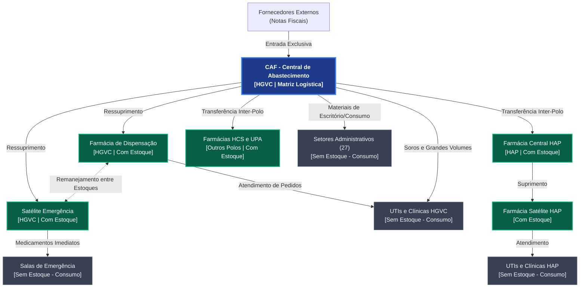

# 🗺️ Mapeamento de Setores e Fluxo de Distribuição — ProGest

> **Documento de Handoff Técnico** — Estrutura topológica de abastecimento, classificação setorial e matriz de fluxo hospitalar.  
> Para detalhes das permissões e papéis de acesso, consulte **[perfis_implementados.md](perfis_implementados.md)**.  
> Para o fluxo operacional dos usuários, consulte **[manual_do_usuario.md](manual_do_usuario.md)**.

---

## 1. Classificação Fundamental dos Setores

Todo o fluxo logístico e assistencial do ProGest está estruturado em **três categorias essenciais de setores**:

```
                       ┌─────────────────────────────────────────┐
                       │                   CAF                   │
                       │    (Central de Abastecimento Farm.)     │
                       │    Único com Entrada de Notas Fiscais   │
                       └────────────────────┬────────────────────┘
                                            │
                    ┌───────────────────────┴───────────────────────┐
                    ▼                                               ▼
         ┌─────────────────────┐                         ┌─────────────────────┐
         │ Setores com Estoque │                         │ Setores sem Estoque │
         │ Farmácias Satélites │                         │ UTIs, Enfermarias,  │
         │ Controle Físico FIFO│                         │ Clínicas e Apoio    │
         │    (Almoxarife)     │                         │    (Solicitante)    │
         └──────────┬──────────┘                         └─────────────────────┘
                    │                                               ▲
                    └───────────────────────────────────────────────┘
                                Abastecimento Local
```

### 1.1. CAF (Central de Abastecimento Farmacêutico)
* **Função:** Matriz logística de suprimentos hospitalares de todo o complexo.
* **Entradas de Mercadorias:** **Exclusividade da CAF**. É o único local do sistema onde ocorrem entradas de estoque via lançamento de Notas Fiscais (NF) de fornecedores externos com rateio de frete e despesas.
* **Distribuição:** Abastece tanto os setores com estoque (ressuprimento) quanto setores sem estoque (consumo direto de grande volume).
* **Perfis Operadores:** Administradores e Almoxarifes da CAF.

### 1.2. Setores com Estoque (`controla_estoque: true`)
* **Exemplos:** Farmácias Satélites (Centro Cirúrgico, Emergência, HAP) e Almoxarifados Setoriais.
* **Entradas de Mercadorias:** Ocorrem **exclusivamente via transferências e movimentações** aprovadas a partir da CAF ou remanejamento entre estoques.
* **Controle Físico:** Mantêm controle rigoroso de saldo e rastreabilidade por lotes com consumo prioritário **FIFO/FEFO** (First In / First Expired, First Out).
* **Perfis Permitidos:** `almoxarife` e `admin`. (Usuários com perfil `almoxarife` só podem ser vinculados a setores com estoque).

### 1.3. Setores sem Estoque (`controla_estoque: false`)
* **Exemplos:** Clínicas de Internação, UTIs (Adulto, Pediátrica, Neo), Salas de Trauma, Centro Cirúrgico e Setores Administrativos/Apoio.
* **Consumo Direto:** O material recebido é considerado consumido imediatamente no ato do atendimento, não gerando acervo de saldo físico nem cadastro de lotes no setor.
* **Modo de Pedido:** Criado via busca cega em **Fazer Pedido** (`/pedidos`), sem visualização de lotes ou do saldo em estoque do setor fornecedor.
* **Perfis Permitidos:** `solicitante` e `admin`.

---

## 2. Topologia Hospitalar por Polo

O ProGest cataloga oficialmente **4 Polos** e **62 Setores Oficiais** interligados pela tabela `setor_distribuidor`:

| Polo | CAF / Matriz | Setores com Estoque | Setores sem Estoque (Consumidores) |
|---|---|---|---|
| **HGVC** (Hospital Geral de Vitória da Conquista) | **CAF - Central de Abastecimento Farmacêutico** | • Farmácia de Dispensação<br>• Satélite da Emergência | • 3 Clínicas (Médica, Cirúrgica, Pediatria)<br>• 8 UTIs (1, 2, 3A, 3B, 4, PED1, PED2, NEO)<br>• 5 Salas Críticas / Emergência<br>• Centro Cirúrgico<br>• 3 Especializados (CHD, Gastro, UNACON)<br>• 27 Administrativos e Apoio |
| **HAP** (Hospital Afrânio Peixoto) | Suprido pela CAF (HGVC) | • Farmácia Central HAP<br>• Farmácia Satélite HAP | • 3 UTIs (5, 6A, 6B)<br>• 4 Assistenciais e Internação |
| **HCS** (Hospital Crescêncio Silveira) | Suprido pela CAF (HGVC) | • Farmácia HCS | • Clínicas Médica e Reabilitação HCS |
| **UPA** (Unidade de Pronto Atendimento) | Suprida pela CAF (HGVC) | • Farmácia UPA | • Salas de Observação e Consultórios |

---

## 3. Diagrama do Fluxo de Distribuição



---

## 4. Regras Operacionais de Movimentação

1. **Origem Unificada dos Pedidos:** Toda requisição (seja de consumo de setor assistencial ou ressuprimento entre estoques) é gerada **exclusivamente na tela [Pedidos](/pedidos)**. Não existe geração de novas requisições dentro da aba Movimentações.
2. **Atendimento e Baixa FIFO:** A aba **Movimentações** (`TabMovimentacoes`) é a bancada de trabalho do almoxarife/farmacêutico para triar pedidos recebidos, inspecionar a alocação sugerida de lotes FIFO/FEFO e confirmar a expedição.
3. **Ambientes e Dados:**
   - **Produção Limpa:** Provisionada via `DatabaseSeeder.php` (62 setores, 417 itens do catálogo SIMPAS Bahia e Super Admin `adminti@gmail.com`).
   - **Demonstração / Testes:** Provisionada via `DemonstracaoSistemaSeeder.php` com movimentações reais de 90 dias, lotes ativos e senha padrão `Admin123`.
